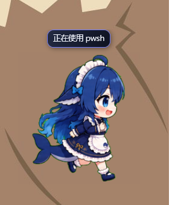
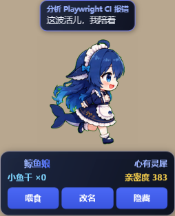
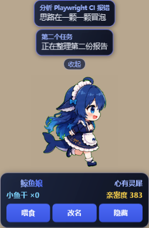
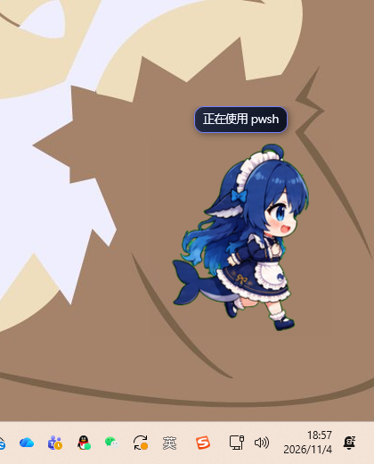

# Desktop overlay spike: a global pet that outlives the client window

Status: experiment + opt-in plugin integration (Windows only).

This folder answers one question: **can the pet stay on the desktop when the
DSH client window is minimized?** The answer is yes, with a window that is not
part of the client's web contents. The plugin launches this program through
`desktopOverlay`; the program is not part of the npm tarball and is never
downloaded by the plugin.



## What it does

`DshPetOverlay` is a small WPF program that:

- polls the running host's **existing** `GET /api/pet/state` and
  `GET /api/pet/pets` routes over loopback (the same routes the in-page pet
  uses, no new API and no auth cookie needed);
- decodes the selected pet's atlas — including WebP with its alpha channel,
  through the bundled `libwebpdecoder.dll` (WPF's Windows WebP codec drops
  alpha) — and plays its state track on a `DispatcherTimer`;
- draws the pet and a status-bubble stack in a frameless, per-pixel transparent,
  always-on-top, taskbar-less window (`WS_EX_TOOLWINDOW | WS_EX_TOPMOST |
  WS_EX_LAYERED`);
- stacks **one bubble per active top-level session** (the GUI's current session
  first). Each bubble shows the GUI session/project title above the original
  status body; the browser half owns the session list and posts that title map
  to the host. The stack starts collapsed: the current bubble plus a `+N` badge;
  the badge expands all sessions and `收起` collapses them again, matching the
  in-page gesture;
- shows a hover panel **below** the sprite, centered on the pet's vertical axis
  and laid out like the in-page panel: the pet name and affinity rank name on
  the first row, treat stock and affinity points on the second, then three
  equal-width `喂食` / `改名` / `隐藏` buttons; feed and rename call the
  existing `POST /api/pet/interact` and `POST /api/pet/set-name` routes, and
  hide closes the desktop window so the page pet returns;
- supports drag-to-move (monitor identity and DPI-independent insets persisted in `%APPDATA%\DshPetOverlay\placement.json`),
  a left-click "pet" interaction, and a right-click menu (reset position /
  quit);
- exits within one poll when the Host that launched it is gone
  (`--parent-pid`), so a crashed host does not leave an orphan window.





The two images above use test-only rendering flags (`--show-panel`,
`--demo-title`, `--fake-session`, `--expand-sessions`, `--snapshot PATH`) so
the panel and title can be captured without racing the mouse; the host never
passes them. `--snapshot` renders the window to a PNG and exits.

Because it is a separate process with its own top-level window, minimizing the
DSH client cannot hide it.



The screenshot above is the pet/taskbar corner of the desktop captured with
the Edge window minimized (`IsIconic = true`): the desktop wallpaper and the
taskbar are visible, and the pet is still animating at the bottom-right. The
rest of that full-screen capture contained unrelated desktop content and was
cropped out. `evidence/window-enumeration.txt` records the window ids, styles
and the minimize call.

## Plugin integration

The host half (`src/host/overlay.ts`) owns the lifecycle:

- Settings → Pet → Desktop → **Desktop overlay** writes the volatile
  `desktopOverlay` config field; the Host spawns the program and kills it when
  the setting or the plugin is turned off, or when the fiber disposes.
- The program path is discovered: `desktopOverlayCommand` (explicit), then
  `$DSH_HOME/pets/.runtime/dsh-pet-overlay/DshPetOverlay.exe`, then package/dev
  locations.
- `GET /api/pet/overlay` reports `{ supported, running, ready, dismissed, pid?, error? }`; the settings card polls it for the live status line.
- The local state view carries `desktopOverlayRunning`; the local browser hides its
  visible in-page sprite only after the companion posts
  `/api/pet/overlay/ready` (first frame on screen), so a starting or broken
  companion cannot leave the user petless. Hidden pets keep a summon button;
  remote browsers keep their own pet. The companion follows the visibility and
  status-bubble settings and exits when a Live2D pet is selected so the browser
  can render it. A clean user close marks the
  companion dismissed; unrelated settings updates do not restart it; turning
  the switch off and on starts it again. The companion also reads the
  client-supplied session/project titles from the state and renders each above
  its bubble body.
- The plugin never downloads an executable: an install publishes the companion
  into `$DSH_HOME/pets/.runtime/dsh-pet-overlay/`.

For LAN access alongside the companion, use a wildcard listener (`webServer.host`
set to `0.0.0.0` or `::`). The launcher connects through `127.0.0.1` or `::1`
at the same port without changing the Host's listener. Binding only to a specific
LAN IP does not provide loopback access and is not supported by the companion.
HTTPS still requires a certificate trusted for the loopback address.

Loopback is a transport check, not proof that the browser shares the Host's
screen. An SSH port forward or a local reverse proxy serving a browser at
`http://localhost:<port>` can look local to both ends: the page pet may hide
while the companion is visible only on the Host's screen. Select **Keep page pet**
in the pet settings for that tab. For a browser on the Host machine using its LAN
address, select **Use desktop pet**; the page remains available until the companion
is ready and returns when it stops. **Automatic** retains the address heuristic.
This per-tab preference does not change the Host setting or authentication rules.
Forwarded headers are not used to infer which screen the browser is on.

**Host and companion versions are coupled, with a legacy bridge.** A companion
whose `companion.protocol` marker is valid and whose SHA-256 hashes match both the exe and managed DLL
(protocol >= 2) must post `/api/pet/overlay/ready`; it is stopped after 15 s if
it never does. A companion without a valid marker — or a stale marker left next
to an older exe — is treated as legacy-ready: the Host hides the page pet once
the process is running (no ready timer), so an older install keeps working
instead of flashing. The Host also passes `--host-protocol 2`; a current
companion treats a 404 from the ready route as a legacy Host (no flag) and stays
visible, but closes when the Host advertised protocol 2 and the route is
missing. Publish the companion from the same checkout as the plugin when
possible.

## Run / install it

Prerequisites: Windows, .NET 8 SDK (build) / Desktop Runtime (run), and a
running DSH host that serves the pet routes (the Desktop profile or `dsh web`).
The host must expose a loopback origin. An explicit LAN-only bind produces a
configuration hint in the pet settings and prevents companion startup.

```powershell
# Build
$env:DOTNET_CLI_HOME = "$PWD\.dotnet-home"
$env:NUGET_PACKAGES = "$PWD\.nuget"
dotnet build -c Release

# Run directly against the current web GUI (adjust the port)
dotnet run -c Release -- --base http://127.0.0.1:59712

# Or publish where the plugin looks for it
dotnet publish -c Release -r win-x64 --self-contained false `
  -o "$env:DSH_HOME\pets\.runtime\dsh-pet-overlay"
```

Options: `--base <url>`, `--pet <id>`, `--size <px>`, `--right <px>`,
`--bottom <px>`, `--atlas <image>`, `--parent-pid <pid>`.

`--atlas` is only a debugging fallback (force a local image); normal runs use
the registry's WebP atlas and the bundled libwebp decoder.

Run the Windows regression checks from the repository root with
`dotnet run --project experiments/desktop-overlay-tests/OverlayRegression.csproj`.
Run these checks manually in an interactive Windows desktop session; the current CI does not run this WPF harness.
They exercise the real WPF window with simulated HTTP responses and a transparent
test window, including startup retry/timeout, gameplay rejection, hide/summon, close, pet switches, settings, mouse
capture, fractional values, rename rejection and scrolling long session stacks.
Monitor geometry tests cover negative coordinates and mixed DPI scales. Physical
dragging between monitors with different DPI still requires a manual smoke test.

> The harness that produced this spike sandboxes spawned executables and blocks
> `Start-Process` of the apphost, so the standalone evidence was produced with
> `dotnet DshPetOverlay.dll ...`. The plugin's Host runs outside that tool
> sandbox; its `spawn` of `DshPetOverlay.exe` was verified end to end.

## Why a separate program is needed today

The pet is a DOM layer mounted on `document.body` of the web GUI (README,
"Mount point"). In the Desktop shell that page lives inside the single
`BrowserWindow` owned by the Electron main process; this spike's client was the
Edge tab at the same URL. Either way the pet is inside the client's web
contents, and minimizing that client stops painting it.

The Desktop shell runs the Host in a **Node child process**
(`dsh-desktop-host`, spawned with `stdio: [ignore, pipe, pipe, ipc]` in
`app.asar/lib/main.js`); that child can only send the fixed IPC messages
`ready`, `shutdown`, `quit-inspection`, `update-tasks` and `platform-session`.
Nothing in the plugin API creates an Electron window, and the preload exposes
no window-creation bridge. A normal browser tab has no window API at all.

## Known limitations

- **Sprite pets only.** `sprite2d` plays correctly; `frames2d` falls back to
  the still named by `atlasUrl`; `live2d` is not rendered. Reusing the web
  renderer would need a WebView2/Chromium host, which is a follow-up.
- **Windows only.** macOS would need an AppKit host; the DSH desktop supports
  Windows and macOS, so a native companion is two code bases.
- **User-installed binary.** The plugin does not ship or download the program;
  an install publishes it under the user runtime directory. This preserves the
  plugin's security posture but is an extra install step.
- **Two surfaces, one state.** The companion and the page both poll the same
  host-authoritative state. The page surface hides while the companion runs, so
  interaction cooldowns and affinity are not double-applied.

## License note

`native/libwebpdecoder.dll` is the libwebp decoder (WebP 1.6.0, BSD-3-Clause,
Google/WebM Project), copied unmodified from a local FreeCAD build for this
spike. It is not part of the npm package. A distribution should pin and ship
the libwebp build together with its license text.
